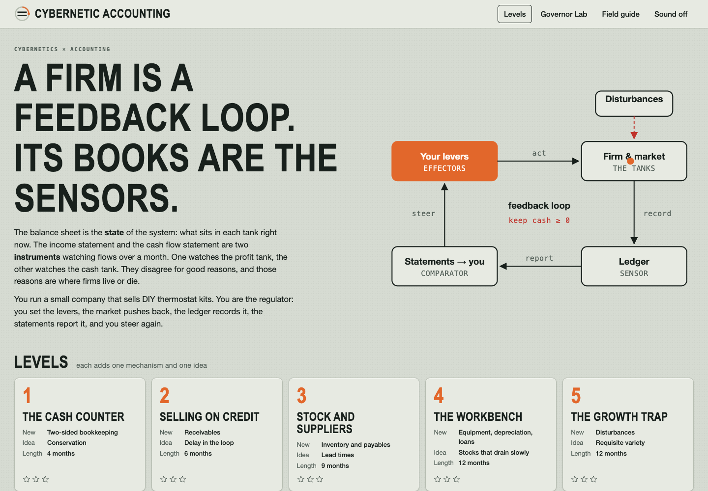
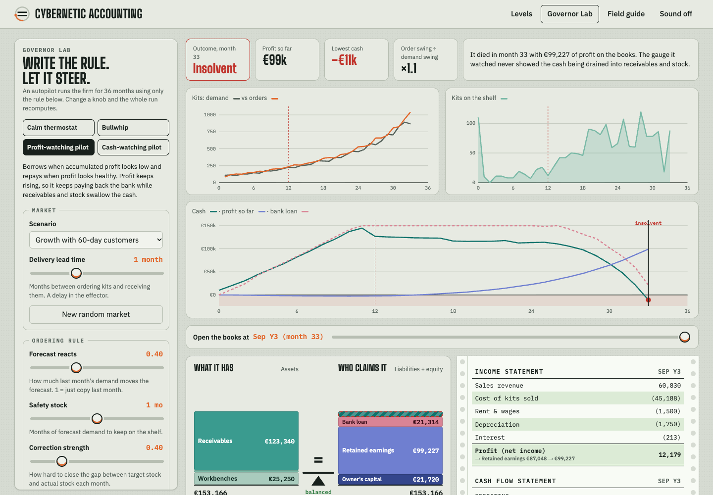
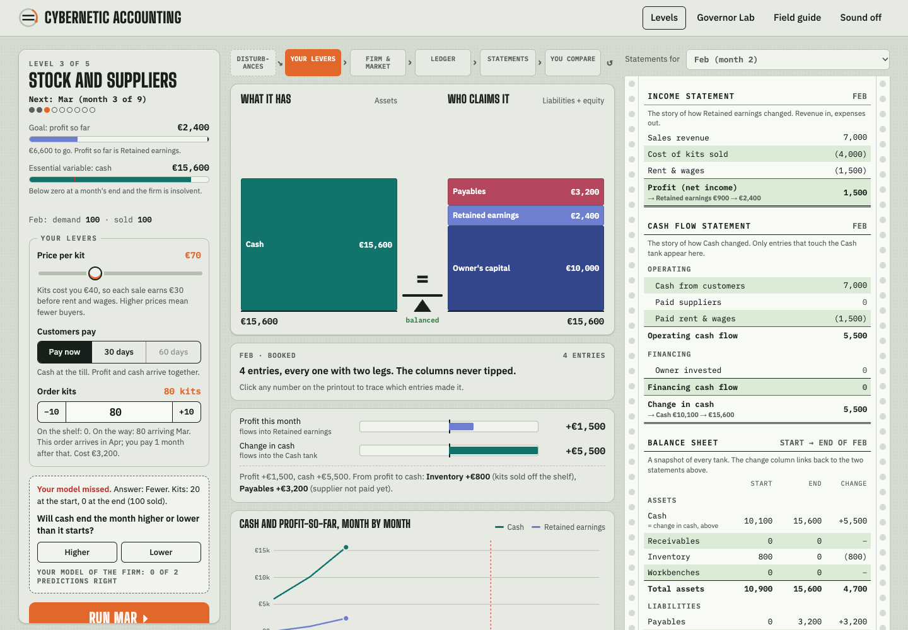

# Cybernetic Accounting

[](https://github.com/eddievanhalensolo/cybernetic-accounting/actions/workflows/test.yml)
[](LICENSE)

**A firm is a feedback loop. Its books are the sensors.**

A browser game about how the three financial statements fit together, taught through cybernetics. You run a small firm that sells DIY thermostat kits and act as its regulator: you set the levers, the market pushes back, the ledger records it, the statements report it, and you steer again.

**[Play it in your browser](https://eddievanhalensolo.github.io/cybernetic-accounting/)**, or clone the repo and open `index.html`. There is nothing to install or build.



## The idea

- The **balance sheet** is the state of the system: what sits in each tank right now.
- The **income statement** and the **cash flow statement** are two instruments watching flows into two different tanks, retained earnings and cash.
- The **ledger** is the sensor. Every event is a balanced journal entry, and all three statements are derived from those entries.

The two instruments disagree for good reasons, and those reasons are where firms live or die. In level 2, generous payment terms bankrupt a profitable firm. In the Governor Lab, an autopilot that watches only profit goes insolvent with about €99,000 of profit on its books, while one following the same rule but watching cash survives.



## What's in it

- **Five levels**, each adding one mechanism and one idea: a cash-only stand (conservation), credit sales (delay), inventory and suppliers (lead times), equipment and loans (slow-draining stocks), growth with disturbances (requisite variety).
- **Balance machine**: two stacked columns that are always the same height. Negative balances move to the other column, hatched (overdraft, accumulated losses).
- **Profit vs. cash meters**, with the gap explained by the other tanks every month.
- **Green-bar printouts**: income statement, cash flow statement, balance sheet, profit-to-cash bridge and journal. Click any number to trace the journal entries behind it and see where else they show up.
- **Predictions** before each month, scored: your mental model is a regulator too.
- **Governor Lab**: configure an autopilot (ordering rule, financing rule, which gauge it watches) and run 36 months. Presets show a calm thermostat, the bullwhip effect, a profit-watching pilot that dies rich and a cash-watching one that survives.
- **Field guide**: eight ideas side by side (cybernetics / accounting) with sources, from double-entry as a conservation law to the good regulator theorem.



It's a teaching toy, so the bookkeeping is deliberately simplified (there are no taxes, for example). It isn't accounting advice.

## Project layout

| File | Role |
|---|---|
| `engine.js` | Simulation. Every event is a balanced journal entry; all statements are derived from entries. Works in Node and the browser. |
| `levels.js` | Level and lab scenario definitions, texts. |
| `app.js` | Interface. |
| `style.css` | Styles, light and dark. |

Progress is saved in your browser's `localStorage`. Fonts load from Google Fonts, with system fallbacks.

## Tests

```sh
node --test test/engine.test.js   # invariants: A = L + E, profit = ΔRE, cash flow = Δcash, indirect = direct; lab lessons hold
node test/browser.mjs [outdir]    # drives headless Chrome through every screen, fails on console errors or phone overflow
```

The browser test needs Node 22 or newer. It looks for Chrome at the default macOS path; on other systems, point the `CHROME` environment variable at the binary.

Run both after any change to `engine.js` or `levels.js`. Level goals were calibrated with an automatic player (see the governor in `engine.js`).

## License

[MIT](LICENSE)
